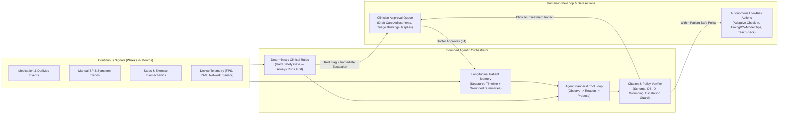

# ShifoHalqa v2+ — Clinical Pilot & Fully Agentic Architecture Blueprint

> **Purpose.** While [DECISIONS](DECISIONS.md) and [PLAN](PLAN.md) define the focused **Lean Grand Final Demo** on `final`, this document preserves the principal-architect roadmap for evolving ShifoHalqa from a winning hackathon demo into a production-grade, hospital-ready, **Fully Agentic** clinical platform in Uzbekistan (starting with Fergana polyclinics) and beyond.

---

## Guiding Principle (Unchanged Across Every Version)

> **AI observes, reasons, and prepares → deterministic clinical rules guard safety boundaries → the assigned clinician approves clinical decisions.**

Even in the **Fully Agentic** architecture (Phase V2.3), autonomy is **strictly bounded**: agents may gather multi-week context, detect subtle adherence/biomechanical/device trends, proactively engage patients within clinician-approved boundaries, and assemble pre-triaged action plans — but **never** diagnose independently, alter prescribed drug dosages, or suppress urgent red-flag escalation.

---

## Phase V2.1 — Production Security, Multi-Tenancy & Hospital Identity

Moves ShifoHalqa from synthetic demo workspaces to real patients and clinics under Uzbekistan Personal Data Law (*Shaxsga doir ma’lumotlar to‘g‘risida* O‘RQ-547) and healthcare privacy expectations.

### 1. Clinic-First, Email-Free Patient Identity
- **Real-world constraint (Uzbekistan):** Elderly hypertension/rehab patients rarely use email. Separate clinician identity from patient identity cleanly:
  - **Clinicians & clinic admins:** Verified email/phone + password/MFA (Supabase Auth or clinic SSO), provisioned strictly via clinic admin approval — never via self-assigned signup roles.
  - **Patients (Android-only or Telegram-only):** Enrolled by their assigned clinic via a **short-lived, single-use enrollment link or 8-character code** showing the verified clinic & doctor name prior to confirmation.
  - **Channel session model:** Issue revocable, Keystore-encrypted device/channel sessions (`patient_channel_sessions` with refresh rotation) linked 1:1 to an active `patients.id` (enforced by partial unique index for active patient enrollment). A patient can bind a second channel (Android ↔ Telegram) using a single-use link code, view/unlink active channels, and recover access at the clinic (which atomically revokes lost-device sessions).
- **Care teams & authenticated caregivers:**
  - Introduce explicit clinic RBAC (`clinic_admin`, `attending_doctor`, `physiotherapist`, `nurse_coordinator`) with audited assignment transfers and cross-cover views.
  - Re-enable authenticated `caregiver` accounts (beyond 24-hour revocable links) with granular patient-controlled consent scopes (`adherence_counts`, `supply_alerts`, `appointment_reminders`) while keeping `doctor_note` and clinical media strictly excluded.
  - Re-enable the `individual` self-guided wellness track gated by a full, validated **PAR-Q+** screening flow (`parq_screenings`).

### 2. Defense-in-Depth Database & API Hardening
- **Least-privilege DB roles:** Provision separate Postgres credentials for Web API (`shifohalqa_web_app`), background workers (`shifohalqa_telegram_worker` limited strictly to delivery queue tables), and migrations (`shifohalqa_migrator`). Retire all legacy direct clinical SQL in `services/telegram_bot` so 100% of clinical operations flow through versioned Next.js HTTP APIs.
- **Anti-abuse & privacy controls:** Eliminate email/phone enumeration in invite endpoints (uniform responses + IP/account rate limits), add per-route rate limiting (Upstash Redis or Postgres sliding window), enforce strict CSP (`default-src`, `script-src`, `frame-ancestors`, `media-src`) and HSTS, and encrypt/redact PHI from application logs.
- **5-tier adversarial security test suite:** Automated CI tests proving direct JWT denial, cross-tenant IDOR immunity, replay rejection on Telegram `initData` & invite codes, Storage immutability, and forged-evidence rejection.

---

## Phase V2.2 — Longitudinal Clinical Depth, Offline Conflict Sync & Reminders

Handles messy real-world outpatient life: changing prescriptions, spotty 3G mobile networks, multi-channel families, and clinician follow-through.

### 1. Immutable Plan Versioning & Complex Schedules
- Replace single-row `plans` overwrite with append-only **`plan_versions`** (`effective_from_date`, `superseded_at`, `created_by_doctor_id`). Editing a drug, dose strength, or time creates a new version for future scheduled days while preserving exact historical plan context for past reports and audits.
- Support selected weekdays (e.g., Mon/Wed/Fri), multi-week tapering schedules, PRN (*zarurat bo‘yicha*) medications, and multi-exercise prescriptions (e.g., upper + lower body on alternating days).

### 2. Full Offline Outbox & Cross-Channel Conflict Protocol
- **Universal Android Room/WorkManager outbox:** Queue **all** patient inputs (`medication_responses`, `manual_bp`, `daily_steps` with midnight carryover preservation, `urgent_symptoms`, `exercise_attempts`) scoped to `(origin, workspace_id, patient_id, session_id)` so account/environment changes never cross-contaminate pending rows.
- **Deterministic conflict vs. correction protocol:**
  - Every dose/reading carries an immutable event log (`evidence_revisions`) plus a `current_revision_id` and monotonically increasing `version`.
  - **Online edit (correction):** Client sends `expectedVersion` → server records a new revision within the 7-day Toshkent window. If the prior revision had clinician `L4` approval, `L4` is explicitly **superseded** (preserved in audit history) and a re-review item opens in the doctor queue.
  - **Offline late sync (conflict):** Client sends `mode: 'offline_sync'`, `baseVersion`, `enteredAt`, and `clientEventId`. If another channel (e.g., Telegram) already recorded a *different* answer after `baseVersion`, the server stores the conflicting candidate (`conflict_pending`), keeps the current server answer in reports, and prompts the patient on both channels to pick the canonical answer. (Equivalent answers deduplicate cleanly.)
- **Clinician reply amendments:** Replace single-column `flags.patient_reply` updates with an immutable **`clinical_responses`** revision table. Amending an approved answer preserves prior text/timestamps in audit history and triggers a fresh notice opening directly to the updated reply.

### 3. Per-Channel Reminder Scheduler & Delivery Operations
- Add `patient_reminder_preferences` (`android`, `telegram`, `both`, `silent`, quiet hours, snooze interval).
- **Android:** Local `AlarmManager` / `WorkManager` notifications (`POST_NOTIFICATIONS`) synced from active plan schedule and automatically cancelled when the dose is marked answered on any channel.
- **Telegram:** Server-side reminder dispatcher (Supabase `pg_cron` or dedicated worker tick) that suppresses reminders for already-answered doses, retries transient Telegram `429 RetryAfter` errors, and surfaces stuck `unknown` delivery states in an operational triage view.

---

## Phase V2.3 — Fully Agentic Clinical Assistant Architecture

This phase evolves ShifoHalqa's Grand Final Supervised AI pipelines into a **Fully Agentic, Longitudinal Clinical Orchestrator** — continuously analyzing patient trajectories and device state over weeks while maintaining strict clinical safety.

### 1. Four Core Agentic Capabilities
1. **Longitudinal Clinical Memory & Pattern Discovery:**
   - Maintain a structured, queryable multi-week patient state (adherence drift by time-of-day, morning vs. evening BP spikes, post-medication side-effect clusters, exercise range-of-motion progression/fatigue across 4–12 weeks).
   - Instead of re-prompting raw rows, equip the agent with typed read-only tools (`getAdherenceWindow`, `getBpTrend`, `getBiomechanicsProgression`, `getPriorClinicianReplies`, `getDeviceHealthMetrics`) so reasoning stays fast, cheap, and citation-exact.
2. **Device-Aware Self-Adaptation (On-Device + Cloud Telemetry):**
   - Track anonymized device capability telemetry over time (average MediaPipe FPS, frame-drop rate, decode latency, RAM pressure, step-sensor availability, upload retry rate on 3G/4G).
   - Over repeated sessions, the agent automatically recommends optimal settings per patient device — e.g., switching a struggling budget Android phone from `Heavy` to `Full`/`Lite`, advising better camera angle/lighting when occlusion repeats across 3+ sessions, or suggesting manual step entry when hardware `TYPE_STEP_COUNTER` is absent or stale.
3. **Proactive Bounded Patient Engagement:**
   - **Adaptive timing & gentle nudges:** Detect recurring miss patterns (e.g., evening dose missed 3 Fridays in a row) and proactively suggest shifting reminder timing or preparing a question for the next clinic visit.
   - **Safe contextual Q&A with deterministic escalation:** Let patients ask free-text questions in Uzbek about their current plan. Every response is grounded strictly in approved plan instructions and verified educational snippets; any mention of new symptoms, side effects, drug interactions, or dose changes triggers an automatic hard-coded escalation card (*«Bu savol shifokor qarorini talab qiladi — shifokorga yuborilsinmi?»*) rather than letting an LLM improvise medical advice.
4. **Proactive Clinician Co-Pilot & Triage Preparation:**
   - Before a scheduled follow-up or whenever multi-signal deterioration crosses a rule threshold (e.g., gradual BP upward drift + rising shallow exercise reps + declining steps), the agent automatically prepares a pre-visit briefing with linked evidence, identifies missing clinical data (e.g., *«Oxirgi 5 kunda kechki bosim o‘lchanmagan»*), and drafts prioritized patient messages awaiting one-tap clinician approval or edit.

### 2. Agentic Safety, Evaluation & FinOps Governance
- **Non-negotiable safety rails:** Deterministic rules always execute *before* and *after* LLM tool loops. Any generated output failing Zod schema validation, DB-ID citation existence checks, or medical-policy classifiers is blocked and replaced with a deterministic fallback.
- **Automated clinical eval suite:** Maintain a regression benchmark of synthetic Uzbek clinical vignettes (missed-dose streaks, hypotension, chest pain, occluded rehab video, adversarial prompt injection via patient notes) run in CI on every prompt or model update.
- **Model routing & cost caps:** Use **Vercel AI Gateway** (primary) + **Cloudflare Workers AI** (fallback) with tiered model routing (fast/cheap models for classification & Teach-Back; stronger multimodal models for complex 4-week briefings & exercise keyframe analysis), hard daily spend ceilings per clinic, and semantic/`prompt_hash` caching.

---

## Phase V2.4 — Full Rehab Catalog, Media Ops, Ecosystem & Observability

### 1. Full 5+ Movement Catalog & Resumable Media Pipeline
- Expand cleared public/clinical exercise fixtures and biomechanical analyzers to `knee_lift`, `shoulder_raise`, and additional orthopedic/cardiac rehab protocols.
- Add on-device client-side video transcoding (Android Media3 Transformer to 480p/720p H.264 target bitrate) and **resumable TUS uploads** for unreliable Uzbekistan mobile networks.
- Automate media retention via scheduled **`pg_cron` + Edge Function** sweeper deleting Storage objects past `min(reviewed_at + 7d, uploaded_at + 30d)` and orphaned incomplete uploads (>24h), while preserving structured measurements and audit logs.
- Optional **short-clip AI video analysis** (3–6 s flagged segments) evaluated against keyframe-only baselines in `docs/BENCHMARK.md` before enabling.

### 2. Telegram & Ecosystem Integrations
- Add Telegram rich chat widgets / enhanced renderers (with graceful classic keyboard fallbacks) once Bot API client coverage stabilizes across Uzbekistan Android/iOS users.
- **Healthcare ecosystem (separate regulatory pilot):**
  - **DMED FHIR** e-prescription import and outpatient summary export.
  - **Asl Belgisi** pharmaceutical Data Matrix barcode scanning alongside DoriMos visual OCR for authoritative package authenticity and strength verification.
  - **Tonometer OCR** (`vitals_ocr_scans`) once real-world Fergana cuff LCD benchmarks meet ≥95% digit accuracy with mandatory patient confirmation.

### 3. Production Observability & Operations
- Replace silent `catch {}` handlers with structured, PHI-redacted JSON logging (`requestId`, `workspaceId`, `route`, `latencyMs`, `aiProvider`, `fallbackUsed`) exported via OpenTelemetry.
- Track real-world KPIs on dashboards: clinician active time-to-review, AI draft acceptance/edit rate, deterministic fallback rate, Telegram delivery latency/`unknown` triage rate, and Android low-end device CV FPS & crash-free sessions.
